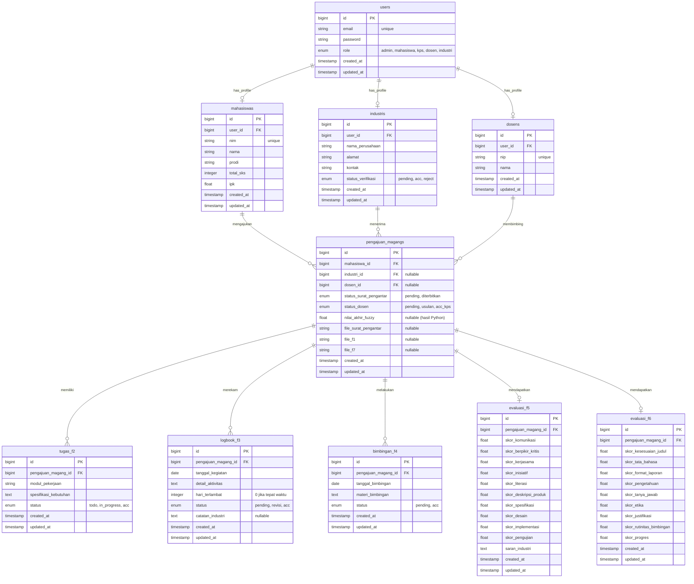

# Product Requirements Document (PRD)
# Sistem Informasi Manajemen PKL/Magang JTIK PNJ 2026

---

## 1. Metadata Dokumen
- **Nama Produk:** Sistem Informasi Manajemen Praktik Kerja Lapangan (SIM-PKL) JTIK PNJ
- **Departemen / Instansi:** Jurusan Teknik Informatika dan Komputer (JTIK), Politeknik Negeri Jakarta (PNJ)
- **Tahun Panduan Acuan:** 2026
- **Status Dokumen:** Production-Ready Draft
- **Bahasa Output:** Bahasa Indonesia

---

## 2. Ringkasan Eksekutif & Visi Produk

### 2.1 Latar Belakang
Praktik Kerja Lapangan (PKL) merupakan mata kuliah wajib di Jurusan Teknik Informatika dan Komputer (JTIK) PNJ yang bertujuan memberikan pengalaman kerja industri bagi mahasiswa. Saat ini, proses administrasi PKL—mulai dari pengajuan surat pengantar, pengalokasian pembimbing, pencatatan logbook harian, hingga evaluasi akhir—memerlukan digitalisasi menyeluruh. SIM-PKL dirancang untuk menggantikan proses berbasis kertas dengan sistem berbasis web terintegrasi.

### 2.2 Visi Produk
Menyediakan platform manajemen PKL yang efisien, transparan, dan terstruktur bagi seluruh pemangku kepentingan (Mahasiswa, Admin Jurusan, KPS, Dosen Pembimbing, dan Pembimbing Industri) dengan memanfaatkan digitalisasi formulir F1–F7, otorisasi berbasis peran (RBAC), serta modul perhitungan penilaian berbasis kecerdasan buatan (*Fuzzy Logic*).

### 2.3 Indikator Keberhasilan (KPIs)
- Reduksi waktu pemrosesan Surat Pengantar dan Penetapan Dosen Pembimbing dari hitungan hari menjadi hitungan jam.
- 100% digitalisasi formulir F1–F7 tanpa memerlukan cetak fisik atau tanda tangan basah.
- Aksesibilitas pencatatan logbook harian industri (F3) dan bimbingan akademik (F4) yang real-time dan ter-audit.

---

## 3. User Personas & Role-Based Access Control (RBAC)

Sistem menerapkan arsitektur *Role-Based Access Control* (RBAC) dengan prinsip **Peran Eksklusif Single-Role** (Setiap pengguna hanya memiliki 1 peran dalam sistem; contoh: KPS tidak merangkap sebagai Dosen Pembimbing).

| Peran (Role) | Hak Akses Utama (Key Privileges) |
| :--- | :--- |
| **Admin Jurusan** | • Import data mahasiswa via Excel / Interface.<br>• Verifikasi pengajuan Surat Pengantar.<br>• Verifikasi & pendaftaran industri baru (generate 1 akun Penanggung Jawab Industri).<br>• Forward pengajuan ke industri yang sudah terdaftar.<br>• Manual reset password pengguna. |
| **Mahasiswa** | • Pengajuan request Surat Pengantar.<br>• Input data perusahaan/industri magang.<br>• Mengajukan preferensi/sugesti Dosen Pembimbing.<br>• Mengisi Logbook Harian Industri (F3).<br>• Mengisi Logbook Bimbingan Dosen (F4).<br>• Mengunduh berkas F1–F7 ber-KOP resmi. |
| **Ketua Program Studi (KPS)** | • Memeriksa dan memberikan *Approval* final penetapan Dosen Pembimbing berdasarkan preferensi mahasiswa.<br>• Memantau status alokasi bimbingan per mahasiswa di prodi terkait. |
| **Dosen Pembimbing (PNJ)** | • Mengisi & menerbitkan Surat Kesediaan Pembimbing (F1).<br>• Memantau progress tugas F2 & logbook F3 (Akses *Read-Only*).<br>• Menginput histori bimbingan F4 (Min. 8 kali).<br>• Mengisi Form Evaluasi Akademik (F6).<br>• Mengisi & menerbitkan Surat Pernyataan (F7). |
| **Pembimbing Industri (DUDI)** | • 1 Akun Penanggung Jawab per Industri.<br>• Membuat, mengubah, dan meng-ACC *To-Do List* / Spesifikasi Tugas F2.<br>• Menyetujui (ACC) atau memberikan revisi Logbook Harian F3.<br>• Mengisi Form Evaluasi Industri (F5) secara rahasia. |

---

## 4. Arsitektur Sistem & Spesifikasi Teknologi

- **Frontend:** Laravel Blade + Tailwind CSS (Melanjutkan serta mempertahankan *layout UI/UX existing*).
- **Backend:** Framework Laravel (PHP MVC) untuk logika bisnis, manajemen database, REST API, dan manajemen dokumen PDF.
- **Engine Perhitungan Penilaian:** Script Python eksternal (Fuzzy Logic Mamdani/Tsukamoto) yang dieksekusi dari *backend* Laravel via Command Process/API Bridge.
- **Database:** MySQL.
- **Notifikasi System:** Trigger Email Alert menggunakan alamat `noreply@pnj.ac.id` / SMTP Gateway.
- **Document Generation:** HTML to PDF Renderer (Dompdf / Snappy) dengan template KOP Surat Resmi JTIK PNJ.

---

## 5. Ruang Lingkup Sistem & Lifecycle PKL

### 5.1 Tahap 1: Onboarding & Pengajuan Surat Pengantar
1. **Import Data:** Admin Jurusan mendaftarkan mahasiswa melalui antarmuka visual (CRUD) atau upload skema file Excel. Sistem membuatkan credential *login* mahasiswa.
2. **Request Surat Pengantar:** Mahasiswa melakukan permintaan Surat Pengantar PKL melalui dashboard.
3. **Penerbitan Surat:** Admin Jurusan memverifikasi pengajuan dan menerbitkan Surat Pengantar digital ber-KOP resmi untuk diunduh oleh mahasiswa.

### 5.2 Tahap 2: Registrasi Industri & Penetapan Dosen Pembimbing
1. **Input Industri:** Mahasiswa menginput data industri/perusahaan tempat diterima magang.
2. **Verifikasi Industri oleh Admin:**
   - *Jika Industri Baru:* Admin meng-ACC data perusahaan, dan sistem secara otomatis memunculkan 1 **Akun Penanggung Jawab Industri**.
   - *Jika Industri Terdaftar:* Admin meneruskan (*forward*) penugasan mahasiswa ke akun industri yang sudah ada.
3. **Sugesti & ACC Dosen Pembimbing:** Mahasiswa mengajukan nama/preferensi Dosen Pembimbing. KPS meninjau preferensi tersebut dan memberikan *ACC / Penetapan Final* Dosen Pembimbing.
4. **Form F1 (Surat Kesediaan Dosen):** Dosen Pembimbing yang telah di-ACC mengisi form F1 di sistem. Sistem men-generate berkas PDF F1 resmi.

### 5.3 Tahap 3: Pelaksanaan Magang (F2, F3, F4)
1. **Form F2 (User Requirement / To-Do List):** Pembimbing Industri membuat daftar tugas (*To-Do List*) dan spesifikasi unit kerja. Pembimbing Industri memegang otoritas penuh untuk menambah/mengubah/meng-ACC penyelesaian tugas. Dosen Pembimbing PNJ hanya memiliki akses *Read-Only*.
2. **Form F3 (Logbook Harian Industri):**
   - Mahasiswa menginput kegiatan harian setiap hari kerja.
   - Waktu pengisian standar adalah pukul **00:00 - 23:59** di hari yang sama.
   - *Fitur Backdate:* Mahasiswa tetap dapat mengisi kegiatan hari-hari sebelumnya yang terlewat, namun sistem memberikan label penanda keterlambatan (misal: "*Terlambat 3 Hari*").
   - Pembimbing Industri bertugas memberikan ulasan, catatan revisi, atau memberikan *ACC*. Dosen Pembimbing memiliki akses *Read-Only*.
3. **Form F4 (Logbook Bimbingan Dosen PNJ):**
   - Diisi saat mahasiswa melakukan sesi bimbingan dengan Dosen Pembimbing PNJ.
   - Bersifat fleksibel/opsional sesuai kebutuhan, namun sistem menerapkan aturan **wajib minimum 8 kali bimbingan** sebelum nilai F6 dapat ditransmisikan.

### 5.4 Tahap 4: Penilaian Akhir & Kelulusan (F5, F6, F7)
1. **Form F5 (Evaluasi Industri - Bobot 60%):** Pembimbing Industri mengisi form evaluasi softskill dan hardskill secara rahasia melalui sistem.
2. **Form F6 (Evaluasi Akademik Dosen - Bobot 40%):** Dosen Pembimbing menginput nilai evaluasi laporan, bimbingan, dan presentasi.
3. **Form F7 (Surat Pernyataan Dosen):** Dosen Pembimbing men-generate lembar persetujuan akhir.
4. **Kalkulasi Nilai berbasis Python (Fuzzy Logic):** Sistem mengeksekusi script Python untuk mengolah angka F5 dan F6 menggunakan metode Fuzzy Logic. Hasil keluaran berupa skor numerik akhir (contoh: `40/50`).

---

## 6. Spesifikasi Formulir Digital (F1 – F7)

| Kode Form | Nama Formulir | Pengisi (Actor) | Otoritas Validasi | Output Berkas |
| :---: | :--- | :--- | :--- | :--- |
| **F1** | Surat Kesediaan Dosen Pembimbing | Dosen Pembimbing | KPS | PDF Ber-KOP Resmi + Checklist & Stempel Digital |
| **F2** | Spesifikasi Tugas & User Requirement | Pembimbing Industri | Pembimbing Industri | Tampilan Dashboard & Rekap PDF |
| **F3** | Logbook Harian Industri | Mahasiswa | Pembimbing Industri | PDF Rekap Logbook (dengan Mark Backdate) |
| **F4** | Logbook Bimbingan Dosen PNJ | Mahasiswa / Dosen | Dosen Pembimbing | PDF Catatan Bimbingan (Min. 8 Sesi) |
| **F5** | Evaluasi Nilai Industri | Pembimbing Industri | Pembimbing Industri | Data Terenkripsi (Confidential Grade) |
| **F6** | Evaluasi Nilai Dosen PNJ | Dosen Pembimbing | Dosen Pembimbing | Form Evaluasi Akademik |
| **F7** | Surat Pernyataan Selesai PKL | Dosen Pembimbing | Dosen Pembimbing | PDF Surat Pernyataan Resmi |

---

## 7. Kebutuhan Fungsional & Acceptance Criteria

### 7.1 Import Data Mahasiswa (Admin)
- **Given** Admin Jurusan berada di halaman Manajemen Mahasiswa,
- **When** Admin mengunggah file Excel berformat `.xlsx` sesuai template standar,
- **Then** sistem memparsing data, merekam entitas mahasiswa ke database MySQL, dan mengirimkan email pemberitahuan akun ke masing-masing mahasiswa.

### 7.2 Logbook Harian & Keterlambatan Backdate (Mahasiswa & Industri)
- **Given** Mahasiswa hendak menginput kegiatan harian F3 untuk tanggal yang sudah berlalu $N$ hari,
- **When** Mahasiswa menyimpan draf logbook tersebut,
- **Then** sistem menyimpan logbook dan menambahkan *badge alert* `"Terlambat N Hari"` pada entitas logbook tersebut di tampilan Pembimbing Industri.

### 7.3 Otomasi Pendaftaran Akun Industri (Admin)
- **Given** Mahasiswa menginput nama perusahaan baru yang belum terdaftar di database,
- **When** Admin Jurusan menekan tombol *Approve/ACC Industri Baru*,
- **Then** sistem membuat 1 akun penanggung jawab industri baru, menghasilkan *temporary password*, dan mengirimkan akses via Email Alert ke alamat perusahaan terkait.

### 7.4 Penetapan Dosen Pembimbing oleh KPS
- **Given** Mahasiswa telah mengirim usulan preferensi Dosen Pembimbing,
- **When** KPS meninjau dan menyetujui usulan tersebut di dashboard KPS,
- **Then** status relasi dosen pada pengajuan magang diperbarui menjadi `acc_kps` dan notifikasi email dikirimkan ke Dosen Pembimbing terkait.

### 7.5 Evaluasi Penilaian berbasis Fuzzy Logic Python
- **Given** Pembimbing Industri telah melengkapi Form F5 dan Dosen Pembimbing telah mengisi Form F6 (minimal 8 sesi bimbingan F4 terpenuhi),
- **When** Dosen Pembimbing menekan tombol *Kalkulasi & Transmit Nilai*,
- **Then** Laravel memanggil script Python Fuzzy Logic, menerima output skor numerik (contoh: `40/50`), dan menyimpan hasil akhirnya pada kolom `nilai_akhir_fuzzy`.

---

## 8. Desain Legalisasi Berkas & Tanda Tangan Digital

1. **Eliminasi TTD Basah:** Sistem **tidak** menggunakan TTD basah, scan TTD, maupun Digital Certificate (e-Sign/QR).
2. **Visual Checklist Oval:** Setiap kolom persetujuan (Approval) pada dokumen PDF F1–F7 digantikan dengan elemen grafis berupa **Simbol Checklist ($\checkmark$) di dalam lingkaran/oval berwarna**.
3. **Stempel Digital Automatis:** Engine PDF generator Laravel secara otomatis menyisipkan citra gambar *Stempel Resmi Institusi/Perusahaan* pada posisi footer dokumen bersamaan dengan munculnya simbol *checklist* persetujuan.

---

## 9. Modul Perhitungan Nilai berbasis Python (Fuzzy Logic)

### 9.1 Alur Integrasi Laravel & Python
```
[ Laravel Backend ] 
       │
       ├─► (Mengambil Skor F5 Industri & Skor F6 Dosen dari MySQL)
       │
       ├─► (Mengeksekusi Process Command: `python compute_fuzzy.py --f5=X --f6=Y`)
       │
[ Python Script (Fuzzy Engine) ]
       │
       ├─► (Fuzzifikasi: Mamdani / Tsukamoto)
       ├─► (Evaluasi Rule Base & Defuzzifikasi)
       │
       └─► (Output JSON: {"score_num": 40, "max_score": 50, "display": "40/50"})
       │
[ Dashboard Mahasiswa ] ◄── (Menampilkan format "40/50")
```

### 9.2 Spesifikasi Output
- Hasil perhitungan tidak ditampilkan dalam bentuk Huruf Mutu (A, B, C, D) di dashboard utama, melainkan ditampilkan langsung sebagai rasio numerik akurat (Contoh: `40/50`).

---

## 10. Diagram Teknis & Pemodelan Sistem

### 10.1 Use Case Diagram (Mermaid.js)

```mermaid
graph TD
    actorAdmin((Admin Jurusan))
    actorMhs((Mahasiswa))
    actorKPS((KPS))
    actorDosen((Dosen Pembimbing))
    actorIndustri((Pembimbing Industri))

    subgraph SIM_PKL_JTIK
        UC1[Import Excel Data Mahasiswa]
        UC2[Request & Terbitkan Surat Pengantar]
        UC3[Input & Verifikasi Perusahaan]
        UC4[Suggest & ACC Dosen Pembimbing]
        UC5[Generate Form F1]
        UC6[Manage Tugas F2]
        UC7[Isi & ACC Logbook F3]
        UC8[Logbook Bimbingan F4]
        UC9[Evaluasi F5 Industri]
        UC10[Evaluasi F6 Dosen]
        UC11[Script Python Fuzzy Grading]
        UC12[Manual Reset Password]
    end

    actorAdmin --> UC1
    actorAdmin --> UC2
    actorAdmin --> UC3
    actorAdmin --> UC12

    actorMhs --> UC2
    actorMhs --> UC3
    actorMhs --> UC4
    actorMhs --> UC7
    actorMhs --> UC8

    actorKPS --> UC4

    actorDosen --> UC5
    actorDosen --> UC8
    actorDosen --> UC10
    actorDosen --> UC11

    actorIndustri --> UC6
    actorIndustri --> UC7
    actorIndustri --> UC9
    actorIndustri --> UC11
```



### 10.2 Entity Relationship Diagram (ERD) Level Fisikal (Laravel Context)



### 10.3 Penjelasan Arsitektur Tabel Database
1. **Autentikasi Terpusat (`users`):** Mengikat seluruh kredensial aktor dalam satu tabel dengan atribut `role`. Profil spesifik tersimpan pada tabel `mahasiswas`, `dosens`, dan `industris`.
2. **Sentral Transaksi (`pengajuan_magangs`):** Berfungsi sebagai entitas utama yang mengikat Mahasiswa, Industri, dan Dosen Pembimbing. Menyimpan status alur persetujuan serta hasil keluaran `nilai_akhir_fuzzy`.
3. **Pencatatan Keterlambatan Logbook (`logbook_f3`):** Menggunakan kolom `hari_terlambat` untuk mencatat selisih hari pengisian secara terotomasi (`0` untuk tepat waktu).
4. **Penilaian Granular (`evaluasi_f5` & `evaluasi_f6`):** Menampung setiap parameter indikator F5 (Softskill & Hardskill) dan F6 (Laporan, Presentasi, Rutinitas Bimbingan) secara terpisah untuk memfasilitasi proses *parsing* data ke modul *Fuzzy Logic*.

---

## 11. Kebutuhan Non-Fungsional, Keamanan & Edge Cases

### 11.1 Keamanan & Kerahasian Nilai
- **Fitur Lupa Password Mandiri Ditiadakan:** Untuk mencegah penyalahgunaan akun, tidak ada mekanisme `Forgot Password` mandiri via email. Reset *credential* sepenuhnya dilakukan oleh Admin Jurusan melalui dashboard Admin.
- **Kerahasiaan Nilai F5:** Form evaluasi yang diisi Pembimbing Industri bersifat tertutup (*confidential*). Mahasiswa tidak dapat melihat rincian poin penilaian F5 secara individu.

### 11.2 Batasan Sistem (Out of Scope)
- **Modul Repositori Laporan PKL (Bab VII Panduan):** Pembatasan/penundaan fitur (dibatalkan sementara untuk iterasi pengembangan saat ini).

### 11.3 Penanganan Pengecualian (Edge Cases)
- **Industri Menolak Mahasiswa:** Jika mahasiswa dinyatakan ditolak oleh perusahaan setelah Surat Pengantar diterbitkan, Admin Jurusan dapat mengembalikan status mahasiswa ke *Draft Request* untuk mengajukan industri baru.
- **Dosen Pembimbing Beralih (Re-assignment):** Jika terjadi pergantian dosen, KPS memiliki hak melakukan pembatalan penugasan dosen lama dan menunjuk dosen baru tanpa menghapus histori logbook F3 yang telah berjalan.